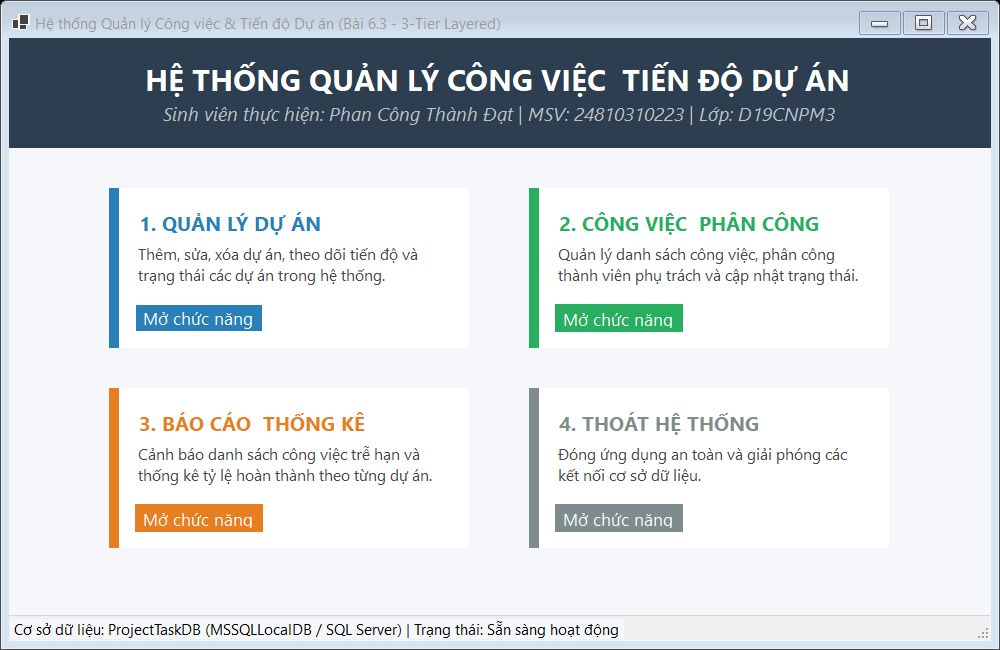
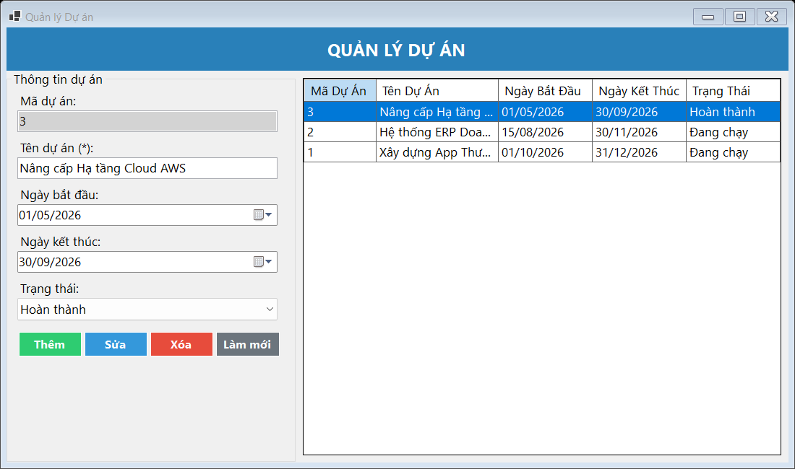
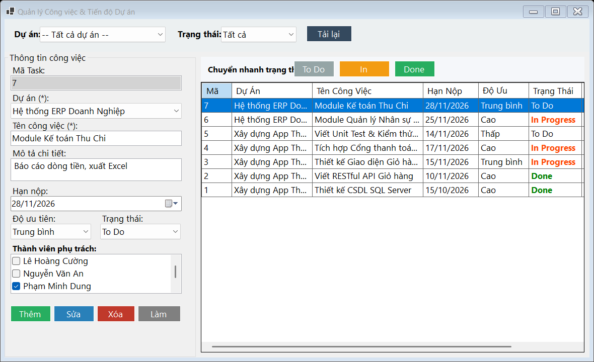
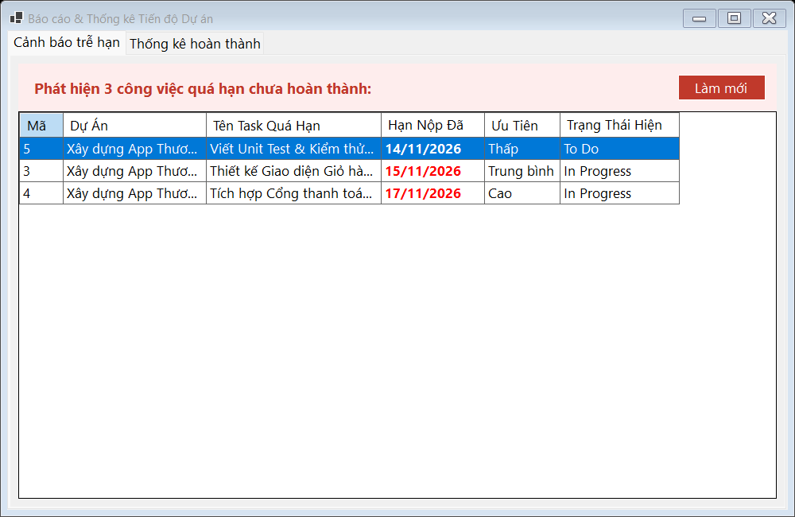
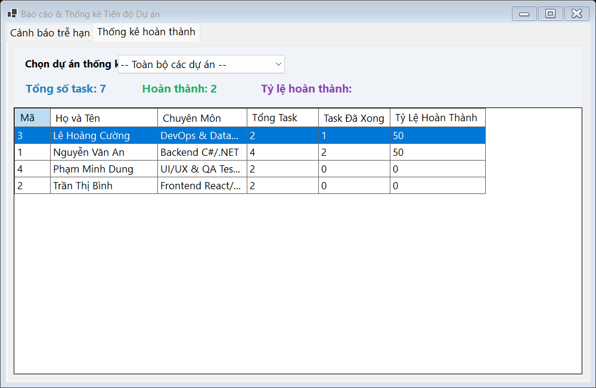

# BÁO CÁO BÀI TẬP 6.3: HỆ THỐNG QUẢN LÝ CÔNG VIỆC & TIẾN ĐỘ DỰ ÁN (PROJECT & TASK MANAGEMENT)

## MỤC 1: THÔNG TIN SINH VIÊN
- **Họ và tên sinh viên:** Phan Công Thành Đạt
- **Mã sinh viên:** 24810310223
- **Lớp :** D19CNPM3

---

## MỤC 2: HÌNH ẢNH KẾT QUẢ CÁC MÀN HÌNH CHỨC NĂNG

### 1. Màn hình Chính / Tổng quan hệ thống:

### 2. Màn hình Quản lý Danh mục (CRUD - Thêm/Sửa/Xóa Dự án):

### 3. Màn hình Thực thi Nghiệp vụ chính (Quản lý Task & Cập nhật Tiến độ):

### 4. Màn hình Báo cáo - Thống kê (Cảnh báo Trễ hạn & Tỷ lệ Hoàn thành):

### 5. Minh họa An toàn Dữ liệu (Phòng chống SQL Injection / Báo lỗi Transaction Rollback):

