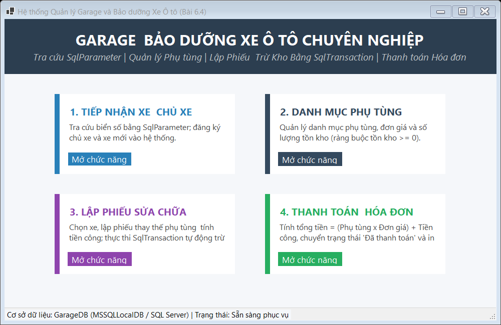
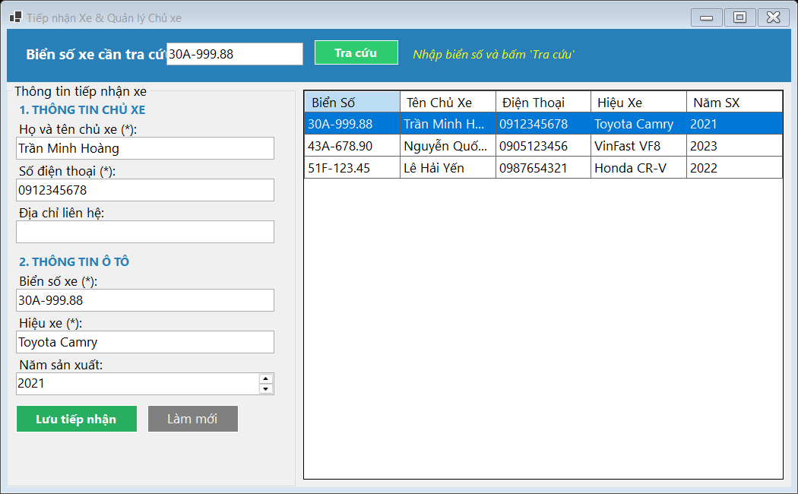
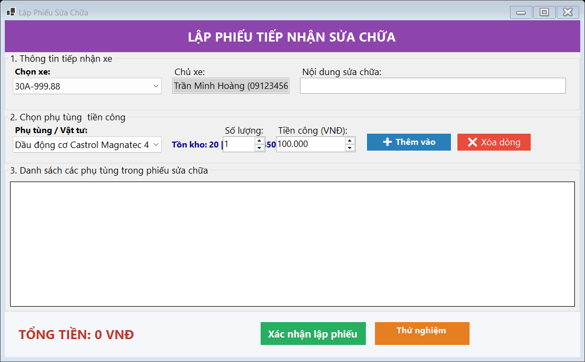
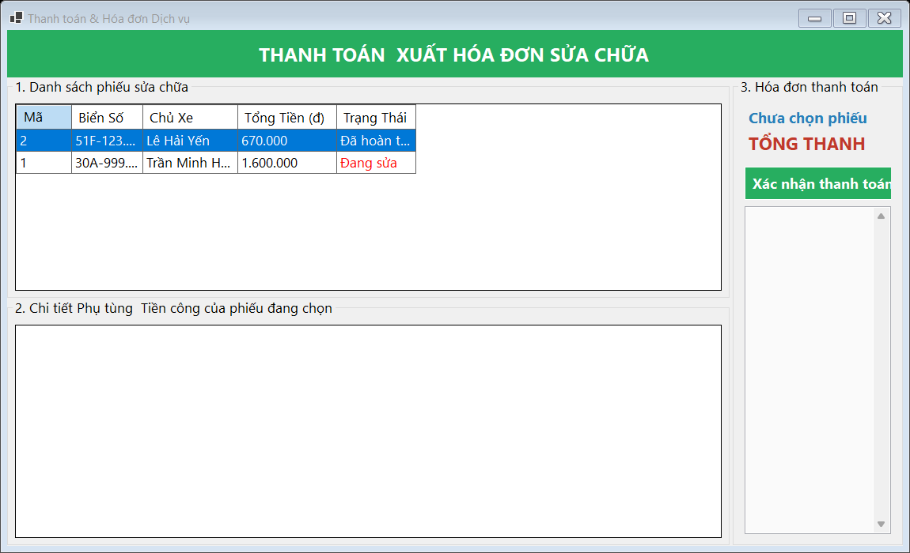
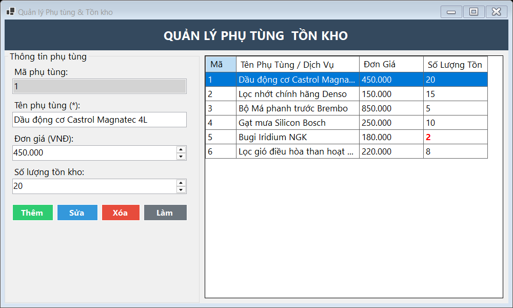

# BÁO CÁO BÀI TẬP 6.4: HỆ THỐNG QUẢN LÝ GARAGE VÀ BẢO BƯỠNG XE Ô TÔ (GARAGE MANAGEMENT SYSTEM)

## MỤC 1: THÔNG TIN SINH VIÊN
- **Họ và tên sinh viên:** Phan Công Thành Đạt
- **Mã sinh viên:** 24810310223
- **Lớp :** D19CNPM3

---

## MỤC 2: HÌNH ẢNH KẾT QUẢ CÁC MÀN HÌNH CHỨC NĂNG

### 1. Màn hình Chính / Tổng quan hệ thống:

### 2. Màn hình Quản lý Danh mục (CRUD - Tiếp nhận Xe & Quản lý Phụ tùng):

### 3. Màn hình Thực thi Nghiệp vụ chính (Lập Phiếu Sửa chữa & Trừ Phụ tùng bằng SqlTransaction):

### 4. Màn hình Báo cáo - Thống kê (Thanh toán & Xuất Hóa đơn):

### 5. Minh họa An toàn Dữ liệu (Phòng chống SQL Injection / Báo lỗi Transaction Rollback):

