# BÁO CÁO THỰC HÀNH WINDOWS FORMS - BÀI TẬP 6.3, 6.4 & 6.5

## MỤC 1: THÔNG TIN SINH VIÊN
- **Họ và tên sinh viên:** Vũ Minh Thành
- **Mã sinh viên:** 24810310190
- **Lớp :** D19CNPM3

---

## MỤC 2: HÌNH ẢNH KẾT QUẢ CÁC MÀN HÌNH CHỨC NĂNG

### 1. BÀI TẬP 6.3: HỆ THỐNG QUẢN LÝ CÔNG VIỆC & TIẾN ĐỘ DỰ ÁN (PROJECT & TASK MANAGEMENT)

1. **Màn hình Chính / Tổng quan hệ thống:**
   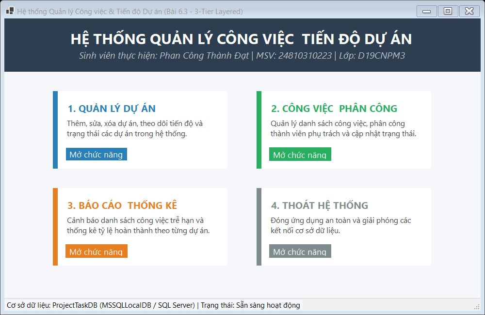

2. **Màn hình Quản lý Danh mục (CRUD - Thêm/Sửa/Xóa Dự án):**
   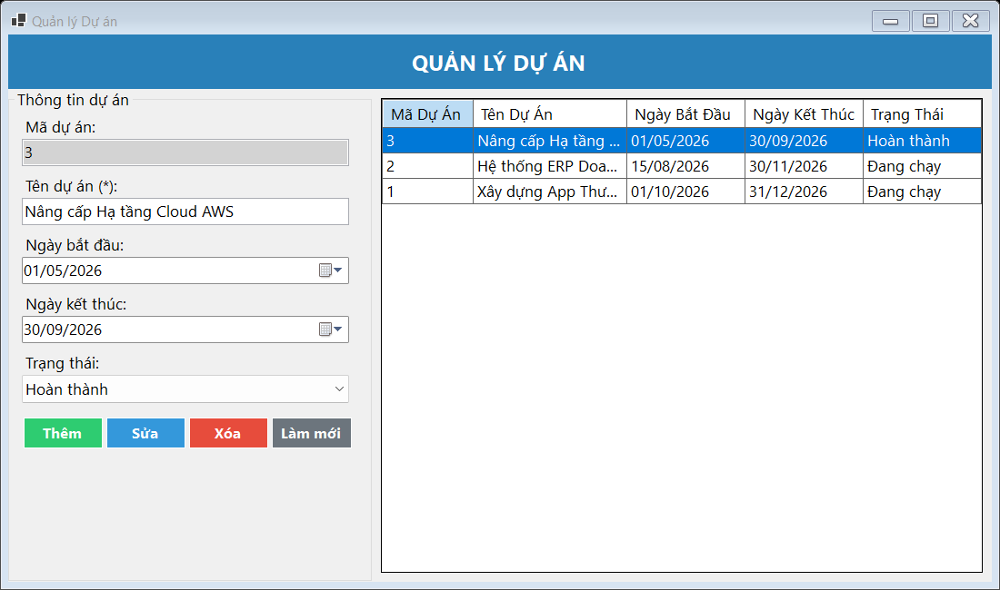

3. **Màn hình Thực thi Nghiệp vụ chính (Quản lý Task & Cập nhật Tiến độ):**
   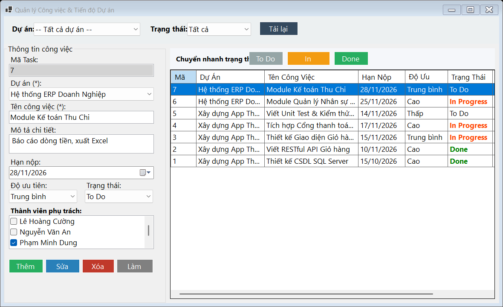

4. **Màn hình Báo cáo - Thống kê (Cảnh báo Trễ hạn & Tỷ lệ Hoàn thành):**
   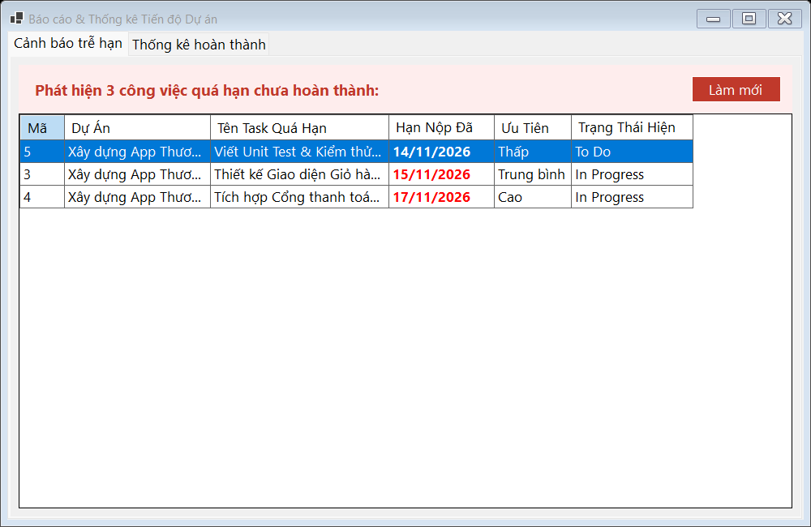

5. **Minh họa An toàn Dữ liệu (Phòng chống SQL Injection / Báo lỗi Transaction Rollback):**
   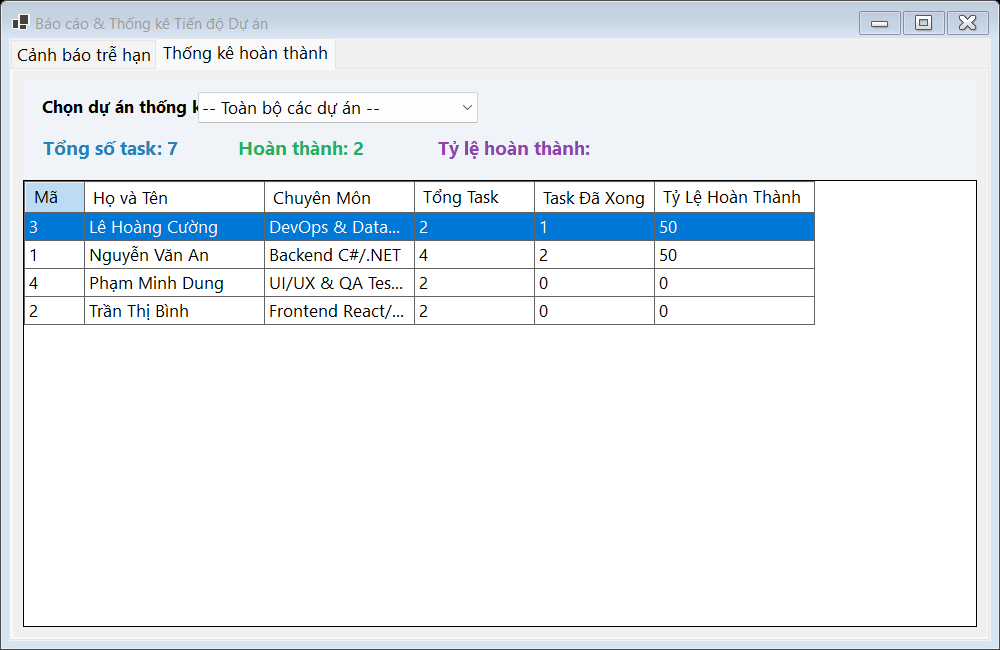

---

### 2. BÀI TẬP 6.4: HỆ THỐNG QUẢN LÝ GARAGE VÀ BẢO BƯỠNG XE Ô TÔ (GARAGE MANAGEMENT SYSTEM)

1. **Màn hình Chính / Tổng quan hệ thống:**
   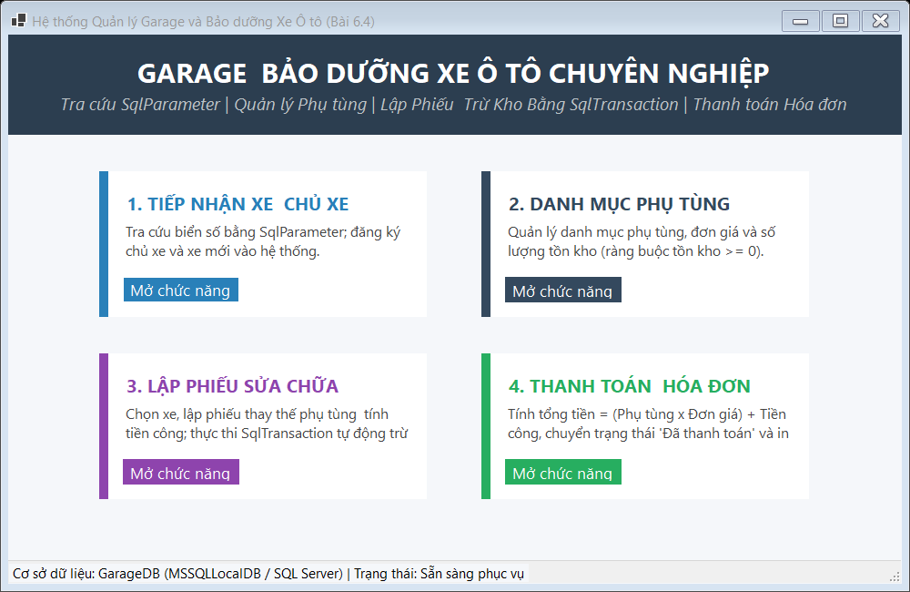

2. **Màn hình Quản lý Danh mục (CRUD - Tiếp nhận Xe & Quản lý Phụ tùng):**
   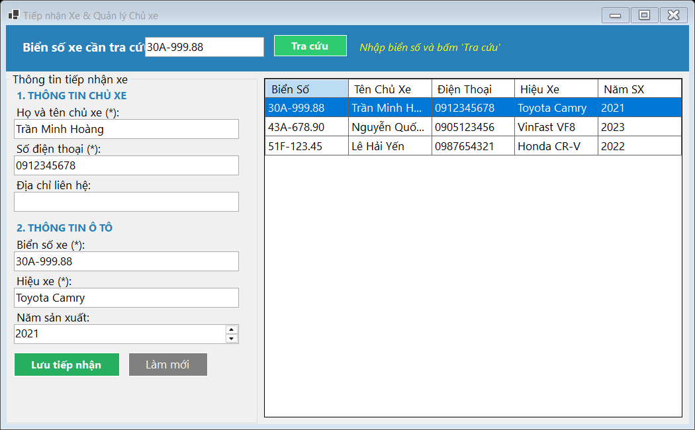

3. **Màn hình Thực thi Nghiệp vụ chính (Lập Phiếu Sửa chữa & Trừ Phụ tùng bằng SqlTransaction):**
   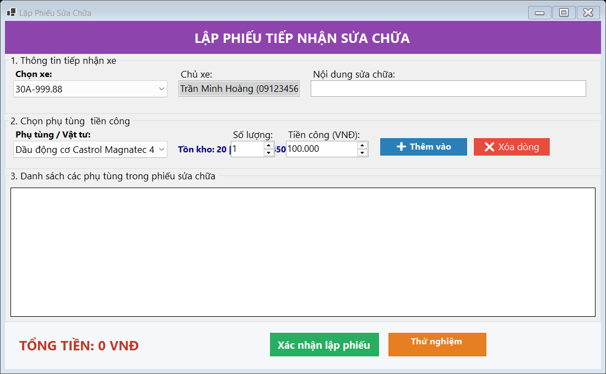

4. **Màn hình Báo cáo - Thống kê (Thanh toán & Xuất Hóa đơn):**
   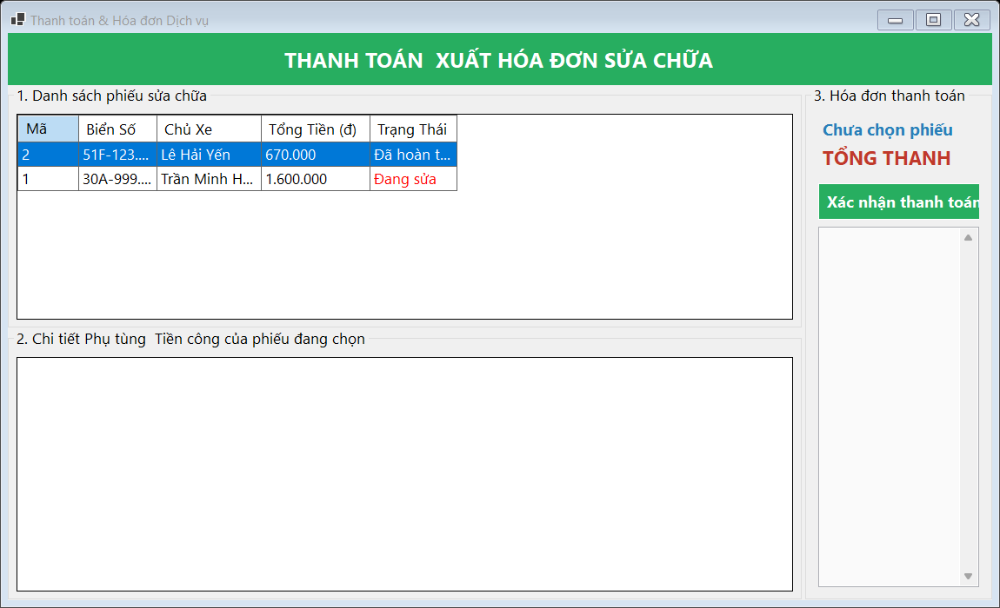

5. **Minh họa An toàn Dữ liệu (Báo lỗi Transaction Rollback khi thiếu kho):**
   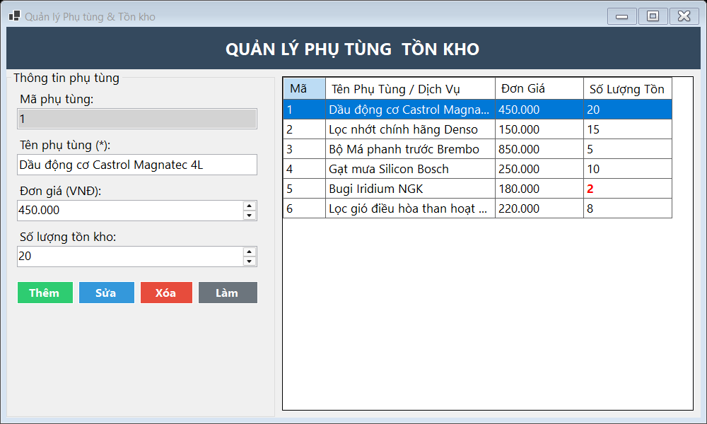

---

### 3. BÀI TẬP 6.5: HỆ THỐNG QUẢN LÝ ĐẶT PHÒNG & DỊCH VỤ KARAOKE (KARAOKE MANAGEMENT SYSTEM)

1. **Màn hình Chính / Tổng quan hệ thống (Sơ đồ Phòng hát Visual Grid):**
   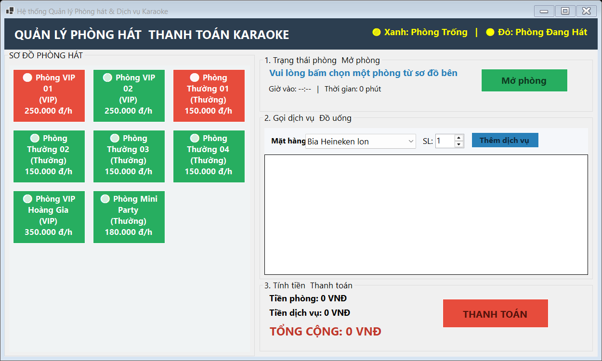

2. **Màn hình Quản lý Danh mục (Mở phòng hát):**
   

3. **Màn hình Thực thi Nghiệp vụ chính (Gọi Dịch vụ - Disconnected Model):**
   

4. **Màn hình Báo cáo - Thống kê (Tính tiền & Thanh toán Hóa đơn):**
   

5. **Minh họa An toàn Dữ liệu (Giao dịch SqlTransaction Khi Thanh Toán):**
   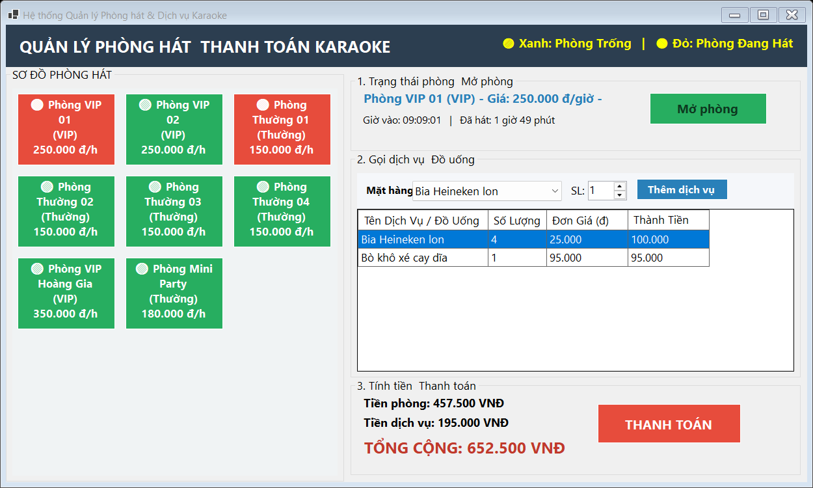
