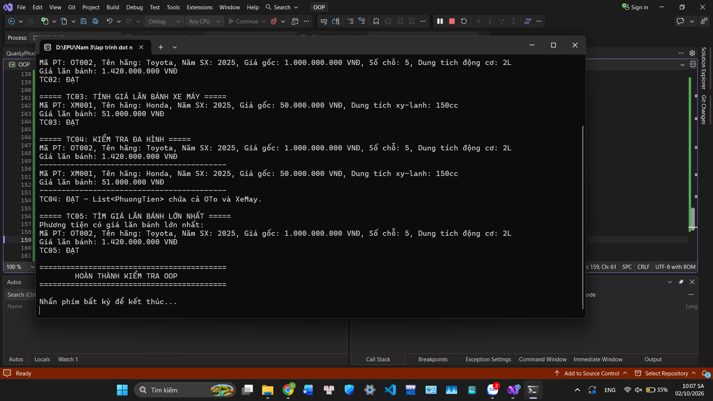

# BÀI 02 - LẬP TRÌNH HƯỚNG ĐỐI TƯỢNG

## 1. Nội dung

Xây dựng chương trình quản lý phương tiện cho AutoSpeed bằng C#.

Chương trình sử dụng các kiến thức:

- Lớp trừu tượng (Abstract Class)
- Kế thừa (Inheritance)
- Đa hình (Polymorphism)
- Override phương thức
- Property và Validation
- List<PhuongTien>
- LINQ

## 2. Các lớp trong chương trình

### PhuongTien

Lớp trừu tượng chứa các thông tin chung:

- Mã phương tiện
- Tên hãng
- Năm sản xuất
- Giá gốc

Có phương thức:

- TinhGiaLanBanh()
- GetInfo()

### OTo

Kế thừa từ lớp PhuongTien.

Có thêm:

- Số chỗ ngồi
- Dung tích động cơ

Thực hiện tính giá lăn bánh theo số chỗ ngồi.

### XeMay

Kế thừa từ lớp PhuongTien.

Có thêm:

- Dung tích xy-lanh

Thực hiện tính giá lăn bánh theo dung tích xy-lanh.

### QuanLyPhuongTien

Quản lý danh sách phương tiện bằng:

List<PhuongTien>

Các chức năng:

- Thêm phương tiện
- Hiển thị danh sách
- Tìm phương tiện có giá lăn bánh lớn nhất
- Tìm kiếm theo tên hãng

## 3. Kết quả kiểm thử

### TC01 - Kiểm tra Validation Năm sản xuất

Năm sản xuất = 1850.

Kết quả: ArgumentException được ném ra.

**TC01: ĐẠT**

### TC02 - Kiểm tra Tính Giá Lăn Bánh Ô tô

Ô tô 5 chỗ, giá gốc 1.000.000.000 VNĐ.

Giá lăn bánh:

1.420.000.000 VNĐ.

**TC02: ĐẠT**

### TC03 - Kiểm tra Tính Giá Lăn Bánh Xe máy

Xe máy 150cc, giá gốc 50.000.000 VNĐ.

Giá lăn bánh:

51.000.000 VNĐ.

**TC03: ĐẠT**

### TC04 - Kiểm tra Đa hình List<PhuongTien>

Danh sách chứa cả OTo và XeMay.

Chương trình tự động gọi phương thức TinhGiaLanBanh() tương ứng của từng loại phương tiện.

**TC04: ĐẠT**

### TC05 - Kiểm tra Tìm Giá Lăn Bánh Max

Phương tiện có giá lăn bánh lớn nhất là ô tô 5 chỗ.

Giá lăn bánh:

1.420.000.000 VNĐ.

**TC05: ĐẠT**

## 4. Hình ảnh kết quả chạy chương trình

